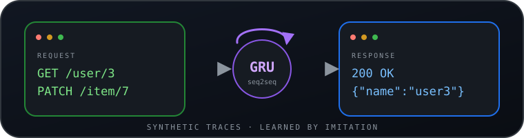

<p align="center">
  
</p>

<p align="center">
  <a href="README.zh-CN.md">简体中文</a> · <strong>English</strong>
</p>

<h1 align="center">http_mock</h1>

<p align="center"><strong>Can a GRU learn to be a server?</strong></p>

<p align="center">
  Synthetic HTTP and key-value protocol traces, plus a character-level seq2seq trained
  from scratch to imitate them. No dataset, no real server, no pretrained weights.
</p>

<p align="center">
  <sub>Archived experiment · no saved outputs or metrics · AGPL-3.0-only</sub>
</p>

## The idea

A server is a state machine with a grammar. This repository asks a narrower question:
if you generate enough request/response pairs from a toy server, can a small
character-level GRU encoder–decoder learn to map request text to response text,
including the state changes hiding behind it?

Everything needed to inspect that question lives in a notebook: the protocol
generator, the character vocabulary, the model, the losses, and the training loop.
There is no server framework and no external dataset. The trade-off is equally
plain: this is an experiment, not a benchmark, library, or maintained service.

## What it can do now

It can generate two kinds of synthetic protocol traffic and train a model to
imitate the generated responses:

| Notebook | Protocol | What it explores |
| --- | --- | --- |
| [`http_mock.ipynb`](notebooks/http_mock.ipynb) | REST-ish HTTP | A relational toy database (`user`, `group`, `item`, `unit`, `craft`, `robot`) behind `GET`, `POST`, `PUT`, `DELETE`, and `PATCH`; a baseline GRU seq2seq. |
| [`http_mock_2.ipynb`](notebooks/http_mock_2.ipynb) | Key-value store | A line-oriented store with `ls`, `du`, `echo`, `get`, `set`, `del`, and arithmetic commands; multi-client traces encoded as a 2-D request/response grid. |
| [`http_mock_3.ipynb`](notebooks/http_mock_3.ipynb) | Key-value store with references | Tuple references, a triple loss (translation plus two reconstruction losses), embedding denoising, and a `Seq2Rnn2Seq` model that runs an RNN over the 2-D grid. |
| [`http_mock_4.ipynb`](notebooks/http_mock_4.ipynb) | Key-value store | An abandoned work-in-progress copy of notebook 3. Its first cell is truncated mid-edit; keep it for provenance, not as an example. |
| [`box.ipynb`](notebooks/box.ipynb) | None | A scratchpad with a `tabulate`/HTML display helper and a plain-text fallback. |

The protocols are deliberately small. A request looks like one of these:

```text
HTTP/1.0 GET /user/3
HTTP/1.0 PATCH /item/7

set a 3
mathadd a 4
ls
```

The generated responses are JSON objects for the HTTP mock and short `ok ...`
lines for the key-value mock. The model never talks to a socket.

**No outputs are saved in this repository.** There are no recorded loss curves,
accuracy numbers, checkpoints, or evaluation split, so the notebooks do not claim
that the models converge or generalize.

## Quick start

The notebooks are standalone and need a CUDA-capable PyTorch install as written.

```bash
git clone https://github.com/ZisIsNotZis/http_mock.git
cd http_mock

# install a CUDA build of PyTorch for your platform:
# https://pytorch.org/get-started/locally/
pip install tabulate jupyterlab
jupyter lab
```

Then open `notebooks/http_mock_3.ipynb` and run all cells. It generates batches on
the fly and trains a model for 200,000 steps, printing samples along the way.
`notebooks/http_mock.ipynb` is the smaller, easier-to-follow starting point.

There is no requirements file, entrypoint, or test command. The notebooks call
`.cuda()` and use `device='cuda'` directly; running on CPU requires editing those
lines and is not a supported path.

## Architecture

```text
protocol state
      │
      ▼
request text ──► character embedding ──► GRU encoder ──► latent state
                                                          │
response text ◄── argmax over vocabulary ◄── GRU decoder ◄┘
```

The target response is fed to the decoder during training (teacher forcing), with
random token dropout on its embeddings. `http_mock_3.ipynb` adds two reconstruction
heads: one rebuilds the request, one rebuilds the response, so the latent state is
pushed to preserve both sides of the exchange. `Seq2Rnn2Seq` also treats the
multi-client request/response grid as a 2-D sequence and runs an RNN across it.

## How to develop

- **Dependencies:** Python 3, PyTorch with CUDA, JupyterLab, and `tabulate`.
- **No build step:** each notebook is self-contained; there is no package to install,
  no shared module, and no generated source.
- **No test suite:** check a change by running the affected notebook on a CUDA
  machine and inspecting the printed traces and predictions.
- **Keep outputs out of git:** clear notebook outputs before committing. This keeps
  the archive readable and avoids committing run-specific results.
- **Preserve provenance:** `http_mock_4.ipynb` is intentionally kept in its broken
  state. Do not "fix" it as part of a general cleanup.

## How to contribute

This is an archive, so maintenance is limited to corrections: a broken notebook, a
wrong claim, a path that no longer resolves, or a migration fix. Open an issue at
[github.com/ZisIsNotZis/http_mock/issues](https://github.com/ZisIsNotZis/http_mock/issues)
with the notebook and cell involved.

If you want to continue the experiment, fork the repository and take it in your own
direction. Feature work and new training results are not expected here.

## Roadmap

### Implemented

- [x] Synthetic REST-ish HTTP traces over a relational toy database.
- [x] A baseline character-level GRU encoder–decoder trained on those traces.
- [x] A line-oriented key-value protocol with arithmetic commands and shared state.
- [x] Multi-client traces encoded as a 2-D grid, with a grid-aware seq2seq model.
- [x] Tuple references, denoising, a triple reconstruction loss, and `Seq2Rnn2Seq`.
- [x] AGPL-3.0-only licensing and an honest project-status record.

### Planned

- None. This repository is archived and has no maintenance or feature roadmap.

**Future vision.** The larger idea is a learned model of a protocol state machine:
a system that could imitate a service from traffic alone, then stand in for it
while testing clients. These notebooks are a small, inspectable step toward that
idea, not evidence that the step works. No metrics were recorded, so there is
nothing here to reproduce or beat.

## Project status

See [`docs/project-status.md`](docs/project-status.md) for the migration record and
the archive boundary. In short: the code is kept for reference, not maintained, and
has not been run as part of this repository's publication.

## License

[AGPL-3.0-only](LICENSE). See [`LICENSE`](LICENSE) for the full text.
